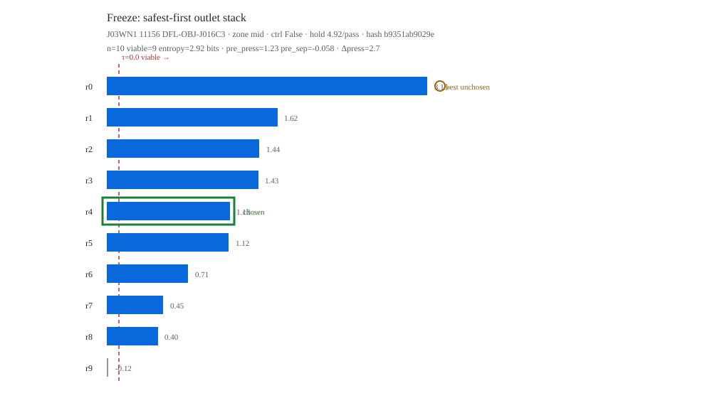

# Football Pass Decisions: scoring passing choices from open tracking data

Open play in football is continuous. Tracking cameras record the movement, but the flow never pauses for scoring. This project cuts it into discrete stop-start states: the freeze as state, the hold as time, the pass choice as decision, each scored so identical inputs give identical numbers.

Here is the chain:

1. **Freeze** — play is frozen as the pass is played, not at receipt.
2. **Attempt** — hold duration only; the decision itself is unmodelled.
3. **Choice** — which outlet gets picked, given the set.
4. **Arrival** — whether the ball beats the press to the intercept.
5. **Control** — whether the receiver's first touch keeps it, judged one second after receipt: ball within 1.5 m counts as controlled, anything else does not.
6. **Resolution** — what the shape looks like 3 seconds later.

What you can build on top:

- Judge the passer: chosen outlet vs best outlet vs set average, per freeze.
- Judge the receiver: controlled or not, against what the cushion predicted.
- Regret per pass: what the road not taken was worth, in the same units.
- Freeze difficulty rating: how hard the decider's job was, before the outcome is known.
- Chain possessions end to end: receiver becomes the next passer. 
- Team fingerprints: decision and execution splits by club, same instrument.

## Freeze

At the moment of the pass: how close the nearest defender is, whether teammates are opening up or closing down, and how many good options exist.



*One mid-pitch freeze, ten outlets, chosen fourth — the gap between picked and best is visible.*

## Attempt

How long the ball sticks: typically just over 2 seconds, with middle-third receptions moving quickest.


## Choice

The safest option gets picked about 4 times in 10; the top two about 7 in 10. Passers facing many similar options pick the safest far less often — dropping from about half to under a tenth.


## Arrival

Sort passes into ten bins by safety margin. Tightest bin: 1 in 5 passes fail. Safest: 1 in 500. Falls steadily in between, in every league tested.


## Control

First touch keeps the ball more often with more time after beating the press — rising from about 4 in 10 to 7 in 10 across the range.


## Resolution

Three seconds later, defences have usually closed back in — but a quarter to a third of controlled receptions leave more space than they found.


## Use it

Run from the repo root; no install, numpy-only.

```python
from src.models.pipeline import run_outlet
from src.core.geometry import PitchPoint
from src.models.pressing.types import PressingActor

# track_ids are arbitrary labels; positions carry the information.
receiver = PressingActor(track_id=9, team_id="own", pos_m=PitchPoint(86.0, 25.0))
presser = PressingActor(track_id=1, team_id="opp", pos_m=PitchPoint(87.5, 26.5))
# source="tracking" asserts full tracking input. source="frozen" raises:
# 360 snapshots carry ordering only — rank with rank_outlets instead.
out = run_outlet(receiver, [presser], PitchPoint(100.0, 29.0), source="tracking")
print(out.describe())
```

Running it prints plain lines, one per number:

```
margin: 0.66s (ball beats the press)
fail rate at this tightness: 20%
control: 44%
loosening when controlled: 26%
value: 0.094 (sticks and breaks shape)
```

That was one outlet on one freeze. Nothing averaged. Change the coordinates and rerun for any freeze. Control reads ordering-only here: frozen snapshot in, no measured flight or live pressers, so treat 44% as ranking, not calibration (the fitted curve is calibrated on measured IDSSE cushions).

Scores come in seconds and chances. Ranks do the ordering: `rank_outlets` sorts outlets safest-first, `margin_decile` groups a margin from 1 (tightest) to 10 (safest) on fixed edges. Rankings transfer across leagues and pace. Seconds are snapshot-specific.

Same freeze, three outlets — this loop prints the ranked table, so the insight above is runnable, not asserted:

```python
from src.models.pressing.calibration import rank_outlets

passer = PitchPoint(100.0, 29.0)
pressers = [PressingActor(track_id=1, team_id="opp", pos_m=PitchPoint(87.5, 26.5))]
outlets = [
    ("right winger", PitchPoint(70.0, 45.0)),
    ("left winger", PitchPoint(70.0, 20.0)),
    ("striker", PitchPoint(86.0, 25.0)),
]
results = [
    (name, run_outlet(PressingActor(track_id=i, team_id="own", pos_m=p), pressers, passer, source="tracking"))
    for i, (name, p) in enumerate(outlets)
]
ranked = sorted(
    zip([n for n, _ in results], [o for _, o in results], rank_outlets([o.margin_s for _, o in results])),
    key=lambda t: t[2].rank,
)
for name, o, r in ranked:
    print(f"rank {r.rank}: {name} margin={o.margin_s:+.2f} control={o.control_prob:.0%} value={o.value:.3f}")
```

```
rank 0: right winger margin=+2.75 control=76% value=0.131
rank 1: left winger margin=+2.10 control=69% value=0.118
rank 2: striker margin=+0.66 control=44% value=0.094
```

Three outlets keeps it readable; real freezes carry seven to ten and the same loop scores all of them.

## Sources

Tracking + events: IDSSE via Hugging Face `pysport/idsse-data` (CC-BY 4.0). Broadcast tracking: SkillCorner Open Data (MIT). Freeze frames: StatsBomb Open Data. Sample game: Metrica. Code is MIT — see LICENSE.

Read next: the gate notes (`arrival.md`, `choice.md`, the rest), the pooled index (`data/pooled/README.md`), and what happens next (`docs/BACKLOG.md`).
