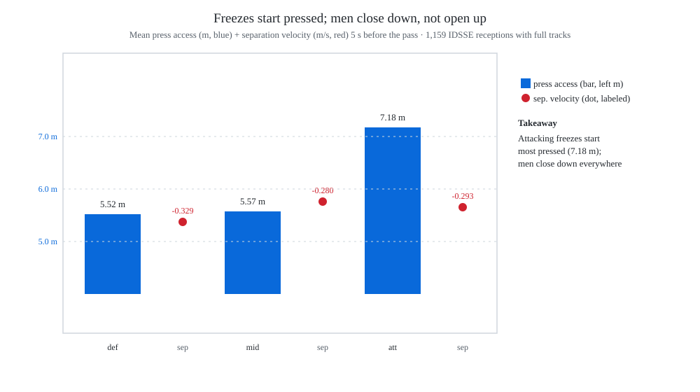
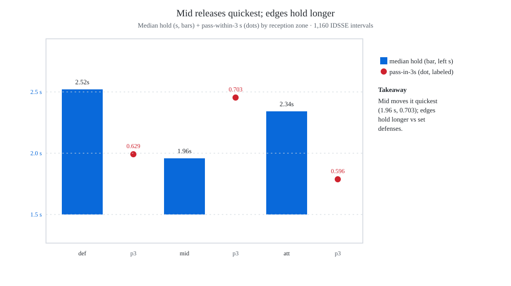
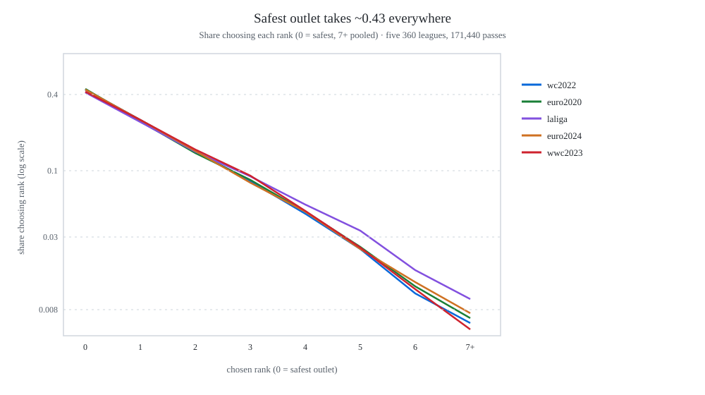
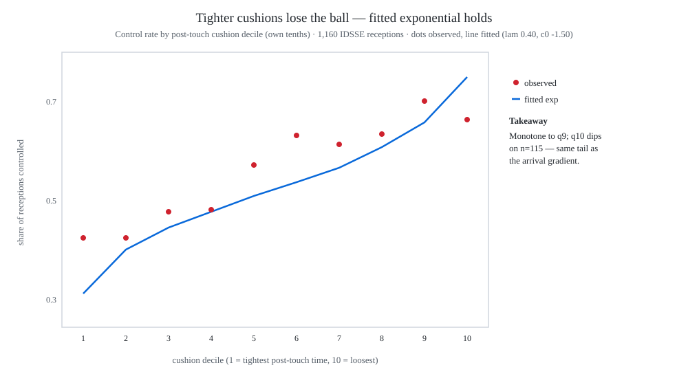
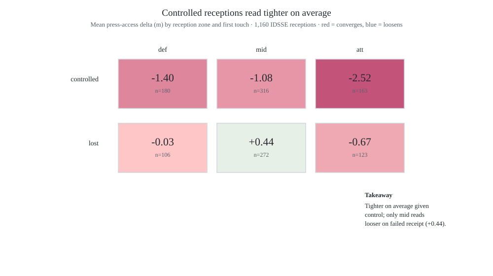

# Football Passing Chain

This project codifies a passing move as six conditional gates, in order:
**freeze** (what the shape looked like) → **attempt** (how long the ball
sticks) → **choice** (which outlet gets picked) → **arrival** (does it
get there) → **control** (does it stick) → **resolution** (did it break
shape). Each gate has its research note, its banked pool, and its pinned
tests; each conditions on the last. One call threads gates 3–5
(`run_outlet`: arrival margin, fitted control, zone loosening, value);
freeze/choice describe the inputs, attempt times the hold — composed
through the shared banked pool, not yet through one entry call.


## Freeze

Press access and separation velocity at t=0, measured over the 5 s of off-ball movement that produced the choice set. The 0↔5 loop does not close: previous-controlled pairs show corr +0.02 (n=655); the unfiltered +0.10 is diluted pairing, not evidence (freeze.md).



## Attempt

Hold duration given receipt, by reception zone. Median 2.16 s overall (2.40 s controlled-only); mid moves it quickest under both conditionings (0.703 pass-within-3 s; 0.664 controlled). Pass exits dominate (958/1160); stoppage is a structural zero. The unplayed ball stays unobserved.



## Choice

The choice-share curve over ranks, pooled. Rank 0 takes 0.41–0.44 on all five 360 leagues; the curve falls monotonically to a pooled tail. Top-2 ranks take ~0.68 of all passes (pooled; LaLiga 0.654), unconditioned on choice-set size. What passers pick, given the freeze.



## Arrival

Margin decile fails at 20–27% at the bottom, 0.2–0.5% at the top — monotone across all ten deciles on each of the five 360 leagues on frozen WC2022 edges. Rank 0 fails at 0.02–0.05; failure rises with chosen rank to rank 6, tail pooled past noise. Absolute seconds are inflated (frozen shape, standing starts). Decile 1 = tightest cushion, decile 10 = safest; play rank (`rank_outlets`) sorts outlets on one freeze safest-first, decile bins one margin against fixed WC2022 edges.


Levels shift with pace, order doesn't. WWC2023 fails ~1.5x the WC2022 rate at equal frozen-shape margin, so one environment multiplier (`pace_k=1.5`) re-scales levels, not edges.


## Control

Retention given arrival, fitted on 1,160 labeled receptions. Shifted exponential wins (NLL 782.6 vs null 793.3); the assumed logistic loses to the null by 2412. Control by cushion decile runs 0.43 to 0.67, monotone to q9 with a q10 dip on n=115.



## Resolution

Structure change given control, by reception zone. Completed passes tighten structure everywhere (press −1.1 to −2.5, compactness −0.2 to −2.2); only failed receptions in mid loosen it (+0.44). Value lives in the right tail, not the mean.



## What the table doesn't care about

Base incompletion spreads 2x across 13 A-League clubs, median attempted cushion spreads 2x — Melbourne City leads both. Rank predicts arrival, not points (points vs base incompletion −0.26; points vs median cushion −0.23).


Full story: [`docs/table-vs-fingerprints.md`](docs/table-vs-fingerprints.md).

## How to use it

```python
from src.models.pipeline import run_outlet
from src.core.geometry import PitchPoint
from src.models.pressing.types import PressingActor

receiver = PressingActor(track_id=9, team_id="own", pos_m=PitchPoint(86.0, 25.0))
presser = PressingActor(track_id=1, team_id="opp", pos_m=PitchPoint(87.5, 26.5))
out = run_outlet(receiver, [presser], PitchPoint(100.0, 29.0))
print(out.margin_s, out.control_prob, out.loosen_prob, out.value)
```

One call threads gates 3–5: arrival margin, fitted control, zone loosening, value. `scripts/reproduce.py` prints the banked tables (numpy + stdlib). `scripts/figures.py` rebuilds figs 8–12 from pinned tests.

## Data & licence

StatsBomb Open Data: github.com/statsbomb/open-data (360 freeze-frames). Metrica sample: github.com/metrica-sports/sample-data. SkillCorner Open Data: github.com/SkillCorner/opendata (MIT). IDSSE: Hugging Face `pysport/idsse-data` (CC-BY 4.0, Bassek et al. 2025). Code is MIT — see LICENSE.

Independent evidence is 5 360 leagues + 1 broadcast pool + 1 measured pool — the 13 banked files are cuts and re-binnings of those seven inputs, not thirteen studies.

## Sources

Research notes per gate: `arrival.md`, `retention.md`, `resolution.md`, `freeze.md`, `attempt.md`, `choice.md`. Pooled evidence: `data/pooled/` (see its index README). Provenance: [`docs/sources.md`](docs/sources.md).

Physics concepts borrowed, values assumed (per-constant notes in `src/physics/arrival_constants.py`): Spearman et al. 2017 (time-to-control); Morin et al. 2016 + Samozino et al. 2021 (sprint profiling); FIFA Quality Programme (ball-surface interaction); Lees & Nolan 1998 (hip-pivot latencies).
